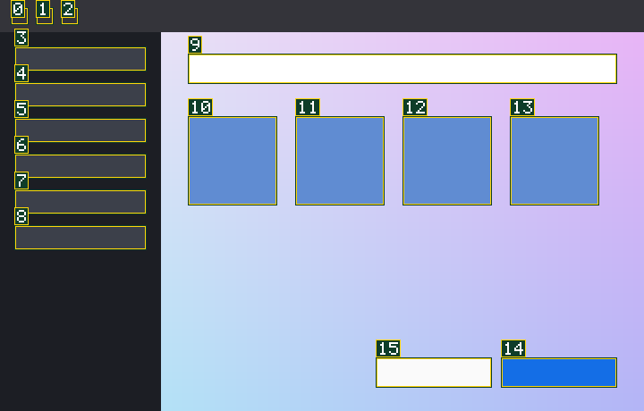

<p align="center"><picture><source media="(prefers-color-scheme: dark)" srcset="assets/logo-dark.svg"></picture></p>

# PenCeh

Управление компьютером для ИИ-агентов на macOS, Windows и Linux. Агент подключается к PenCeh как к MCP-серверу (Model Context Protocol, стандартный протокол подключения инструментов к агенту), видит окна программ, нажимает кнопки и вводит текст. Работает с любой моделью, в том числе со слабой.

Исходный код закрыт. Здесь описание и материалы продукта.

## Два режима

- **Окно (по умолчанию).** Агент работает в фоне: не двигает ваш указатель, не забирает клавиатуру и не уводит фокус. Вы продолжаете работать на том же компьютере.
- **Весь экран.** Выключен. Включается только вами: настройкой `allow_full_screen`. Пока режим включён, по краям экрана видна рамка, а в строке меню значок «PenCeh смотрит за всем экраном».

## Как агент видит экран

Снимок окна приходит как картинка с пронумерованными элементами и как текстовый список тех же элементов. Агент нажимает по номеру, а не по координатам, поэтому слабой модели не нужно угадывать пиксели.

<p align="center"></p>

После каждого действия PenCeh возвращает, что изменилось. Ошибка всегда содержит подсказку, что сделать дальше.

## Курсор агента

У агента свой курсор: белая стрелка на зелёной подложке со свечением. Он плавно летит к цели, при нажатии показывает волну и виден только над окном, с которым работает агент. На снимки для модели он не попадает.

## Платформы

| Система | Состояние |
|---|---|
| macOS | основная, проверена живыми сценариями |
| Windows 10, Server 2019 | проверены полным набором |
| Linux (X11) | работает; Wayland — с ограничениями |

Ограничения Linux: нужна glibc 2.39 или новее (Ubuntu 24.04, Debian 13); на Wayland нет рамки режима «весь экран».

## Скачать

Последняя версия: [Releases](https://github.com/CodoCeh/penceh/releases/latest). Контрольные суммы лежат рядом, в `SHA256SUMS.txt`.

**macOS (Apple Silicon)** — `penceh-macos-arm64.zip`:

```
unzip penceh-macos-arm64.zip -d ~/Applications
xattr -dr com.apple.quarantine ~/Applications/PenCeh.app
mkdir -p ~/.local/bin && ln -sf ~/Applications/PenCeh.app/Contents/MacOS/penceh ~/.local/bin/penceh
~/.local/bin/penceh permissions grant
```

Вторая команда снимает блокировку macOS на программу из интернета. Последняя открывает настройки: включите PenCeh в «Универсальный доступ» и «Запись экрана и системного звука».

**Windows 10 и новее (x64)** — `penceh-windows-x64.zip`: распакуйте, запускайте `penceh.exe`. Windows может показать предупреждение SmartScreen («Подробнее» → «Выполнить в любом случае»): программа пока без цифровой подписи.

**Linux (x64, glibc 2.39 и новее)** — `penceh-linux-x64.tar.gz`:

```
tar xzf penceh-linux-x64.tar.gz
install -m 755 penceh ~/.local/bin/penceh
```

## Подключение

Подходит любой агент, который умеет MCP по stdio: Claude Code, Codex, Grok, opencode, Cursor, Antigravity. Команда запуска сервера:

```
penceh mcp
```

Например, для Claude Code:

```
claude mcp add -s user penceh -- ~/.local/bin/penceh mcp
```

Проверка: `penceh --version`.

## Проверено

Сценарии приёмки: Калькулятор (6×7=42), ввод в TextEdit, Finder, форма в Safari. Их проходят Claude Code, Codex и Antigravity, во время прогона указатель и фокус пользователя не сдвигаются.

---

<p align="center">Выковано в <a href="https://codoceh.ru"> КодоЦех</a></p>
